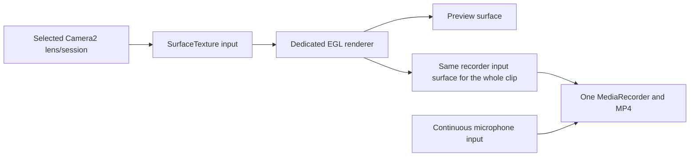

# OnePlus 9 Pro: optical lens changes during one video recording

Research date: 2026-11-07. Target reported by the user: OnePlus 9 Pro, Android 14, Camera2 enabled. The phone was unavailable for connected testing. Code observations below describe the existing classic/Studio paths inspected before the new optical video path; API facts and proposed implementation choices are identified separately.

## Required behavior and zoom scale

The user wants continuous zoom across the full supported range while saving one video with continuous audio. Their required lens selection is ultra-wide below 1x, main from 1x up to (but excluding) 3.3x, and telephoto at 3.3x and above. This applies to every requested zoom value in either direction; 10x is only an arithmetic example, not a special case or a zoom limit. They explicitly selected an app-managed recording pipeline. A preview-only handoff, a lens change after stopping, or separate files for each lens does not satisfy this requirement.

OnePlus lists the rear main and ultrawide cameras as 23 mm and 14 mm equivalent, and the telephoto as 3.3x/77 mm. These are product specifications, not evidence that the Android 14 Camera2 interface exposes every lens or provides automatic handoff. [Official OnePlus 9 Pro camera specifications](https://www.oneplus.com/rs/9-pro)

Use one main-relative zoom coordinate throughout the UI, lens policy, and recorder:

| Requested zoom range | Intended camera |
| --- | --- |
| Supported minimum up to, but excluding, 1x | Ultra-wide |
| 1x up to, but excluding, 3.3x | Main |
| 3.3x through the supported maximum | Telephoto |

Exactly 1x selects main and exactly 3.3x selects telephoto. Values between 3.2x and 3.3x remain on main until the telephoto threshold is reached. Pinch, slider, and lens-button requests all use the same selection policy during recording.

```text
global zoom = selected lens optical factor * selected lens digital ratio
digital ratio = requested global zoom / selected lens optical factor
10x global on a nominal 3.3x telephoto = 10 / 3.3 = 3.030303...x digital
```

| Requested global zoom | Intended lens | Digital ratio using nominal stops |
| --- | --- | --- |
| 0.6x | Ultrawide | 1x |
| 1x | Main | 1x |
| 2x | Main | 2x |
| 3.3x | Telephoto | 1x |
| 6.6x | Telephoto | 2x |
| 10x | Telephoto | 3.030303x |

The 0.6x stop is a rounded label: 14/23 is approximately 0.609. Inventory-derived optical factors and nominal UI labels must remain consistent. Do not compare bare focal lengths from differently sized sensors as though they were equivalent focal lengths. Do not derive the whole zoom range from the initially opened ultrawide's digital maximum: that incorrectly allows its limit to constrain later main/telephoto operation. If the selected lens cannot supply the required crop, report the achievable global value instead of displaying an unachieved 10x.

## Verified gap in the existing code

| Existing code | Observed behavior | Consequence |
| --- | --- | --- |
| [OpClassicController](../app/src/main/java/net/sourceforge/opencamera/OpClassicController.java), `buildLenses()` | Logical zoom mode is inferred from a logical camera, no physical override, and a minimum zoom below 0.95. Otherwise, the slider maximum is partly derived from the current lens's digital range. | These values alone do not prove that physical lenses will switch during recording. The starting lens can also influence the displayed range. |
| Same file, `onZoomDrag()` | Outside logical mode, it divides requested zoom by the current lens factor and applies digital zoom to that camera. | Dragging can continue cropping the ultrawide rather than opening the next optical lens. |
| Same file, `onZoomDragEnd()` and `switchToLens()` | The settled gesture selects the longest accessible lens at or below the requested global zoom. A different camera is opened only if `preview().canSwitchCamera()` permits it. | An idle lens-selection fix can work while the live recording requirement remains unfulfilled. |
| [Preview](../app/src/main/java/net/sourceforge/opencamera/preview/Preview.java), `canSwitchCamera()` | Returns false during `isVideoRecording()`. | The classic camera reopening path intentionally cannot perform the requested live handoff. Removing only this guard would not create a continuous encoder pipeline. |
| [StudioEngine](../app/src/main/java/net/sourceforge/opencamera/studio/StudioEngine.java), `applyZoom(float, boolean)` | Rejects a change that needs another lens opened while `recording` or `longRunning`. It can change `primary` among already open pipes and call `gl.setPrimary()`. | A selected preview camera is not proof that one saved video follows that selection. |
| Same file, `startRecording()`, `configure()`, `applyRepeating()` | Creates a `MediaRecorder` and named output file per `CamPipe`, attaches each recorder surface directly to its camera session, and assigns audio to the primary pipe at recording start. | Studio's existing recording model saves per-lens files; changing the GL preview's primary camera does not redirect those recorder inputs into one file. |

The missing behavior is therefore camera-input switching behind a continuous recording output. It is not resolved by increasing a slider limit or by improving only idle lens selection.

## What Android's public APIs establish

**Logical cameras are one possible implementation, not an assumption about this phone.** Android exposes logical devices backed by physical cameras and provides physical stream selection and metadata. Physical request controls may be limited. [AOSP multi-camera support](https://source.android.com/docs/core/camera/multi-camera)

`CONTROL_ZOOM_RATIO`, available since API 30, can express combined optical/digital zoom and zoom-out. A reported ratio range does not by itself establish which physical camera supplies a particular video frame. [Camera2 zoom-ratio request semantics](https://developer.android.com/reference/android/hardware/camera2/CaptureRequest#CONTROL_ZOOM_RATIO)

Where advertised, `LOGICAL_MULTI_CAMERA_ACTIVE_PHYSICAL_ID` identifies the physical camera backing a logical stream and can demonstrate an actual handoff. The key is optional: its absence does not establish that handoff is impossible. Record requested and returned zoom along with this ID when assessing a logical-camera alternative. [Active physical camera result metadata](https://developer.android.com/reference/android/hardware/camera2/CaptureResult#LOGICAL_MULTI_CAMERA_ACTIVE_PHYSICAL_ID)

**Physical output assignment belongs to session configuration.** `OutputConfiguration.setPhysicalCameraId()` maps an output to a physical camera belonging to the logical device. It must be set before session creation; changing it afterward has no effect. It is not a live request-level lens selector. A design can instead choose among previously configured outputs, or rebuild the camera session while retaining the app's encoder. [Physical camera output configuration](https://developer.android.com/reference/android/hardware/camera2/params/OutputConfiguration#setPhysicalCameraId(java.lang.String))

**Simultaneous rear cameras are not a universal guarantee.** `getConcurrentCameraIds()` returns supported combinations of independently opened devices; it excludes physical cameras accessible only through a logical parent. Concurrent operation also imposes opening/configuration order and stream limits. Check the advertised set and concrete session configurations before enabling overlap. [CameraManager concurrent camera contract](https://developer.android.com/reference/android/hardware/camera2/CameraManager#getConcurrentCameraIds())

Logical multi-camera stream guarantees are narrower than arbitrary simultaneous private preview/recording outputs. Physical-output combinations beyond those guarantees require device validation. [Android multi-camera stream guarantees](https://developer.android.com/media/camera/camera2/multi-camera)

**Rendering can separate a camera producer from a recording consumer.** A `SurfaceTexture` exposes camera buffers as an external GLES texture. Its update also supplies the buffer's transform and timestamp. Android documents a camera-to-texture pipeline rendered to display and encoder surfaces, and recommends a dedicated thread for more complex GL work. [AOSP SurfaceTexture and continuous capture architecture](https://source.android.com/docs/core/graphics/arch-st)

With `MediaRecorder.VideoSource.SURFACE`, `getSurface()` is available after `prepare()`; input rendered before `start()` is discarded. Pause/resume can retain a recording without full reconfiguration. For this design, “persistent” means keeping the same recorder and input surface for the clip; it does not require `MediaCodec.createPersistentInputSurface()`. [MediaRecorder surface and lifecycle contract](https://developer.android.com/reference/android/media/MediaRecorder)

## Selected implementation design

This section is the project's design, not a claim that OnePlus supplies these transitions automatically.



Use an isolated normal-Video `OpticalVideoActivity`/engine/renderer path. The activity owns UI/lifecycle, the engine owns capability selection and serialized Camera2 work, and the renderer owns textures and EGL targets. Existing specialty recording and external capture flows retain their own behavior.

1. Build the usable rear lens list from actual camera characteristics and legal direct/logical-parent opening paths. Do not guess OnePlus camera IDs or equate an enumerated hidden ID with a usable recording camera.
2. Choose a supported size/FPS configuration before recording. Keep the encoder format fixed for the clip and allow only lenses that support the selected capture profile. A 1080p/30 default is a preference to validate, not a guaranteed three-lens capability.
3. Create one output target, recorder, audio capture, and encoder surface. GL renders the selected camera texture both to preview and to that encoder surface. Starting another camera must not prepare/start another recorder or change the output file.
4. At an optical boundary, serialize camera close/open operations. Preserve the last valid displayed texture while the old camera releases and the new camera starts. Use a distinct input generation/slot so late frames cannot be mistaken for the replacement camera.
5. Commit the visual handoff only after the first valid frame of the intended new input. Keep the old texture alive until that commitment. Show requested zoom separately from confirmed lens state during the transition.
6. Apply the requested residual crop exactly once. If Camera2 supplies the crop, GL must not repeat it; if GL supplies it, keep the camera crop neutral. Preview and saved video must use the same zoom and orientation policy.

Holding the previous frame can keep the clip and audio running during a sequential reopen, but the viewer may see a brief freeze, framing shift, or exposure/color change. Stock-camera-level smoothness is not established. Concurrent prewarming is a later optimization only for advertised, validated combinations; it is not required for the initial sequential design.

### Capture profiles and timestamps

`StreamConfigurationMap` supplies compatible output sizes and minimum frame durations. A zero minimum duration means that timing information is unavailable, not that arbitrary frame rates work. Use these values with advertised AE FPS ranges and actual session success when selecting a common profile. [Camera2 stream size and timing queries](https://developer.android.com/reference/android/hardware/camera2/params/StreamConfigurationMap#getOutputMinFrameDuration(java.lang.Class,%20android.util.Size))

Sensor timestamps are monotonic within their defined source, but their relationship to other clocks depends on `SENSOR_INFO_TIMESTAMP_SOURCE`. [Camera timestamp source characteristic](https://developer.android.com/reference/android/hardware/camera2/CameraCharacteristics#SENSOR_INFO_TIMESTAMP_SOURCE)

`REALTIME` uses the elapsed-realtime timebase; Android explicitly says the usual camera-to-encoder audio compensation is absent when an app receives buffers and later submits them to an encoder. `UNKNOWN` timestamps cannot be accurately compared across camera instances, although their timebase is approximately suitable for audio synchronization. [Camera timestamp timebase and compensation rules](https://developer.android.com/reference/android/hardware/camera2/CameraMetadata#SENSOR_INFO_TIMESTAMP_SOURCE_REALTIME)

The renderer therefore needs an app-owned presentation timeline that survives camera generations, normalizes input clocks, never runs backward, and preserves real elapsed recording time during a held frame. Do not concatenate raw timestamps from different cameras. Pause/resume must avoid counting a pause twice between recorder behavior and renderer offsets. Validate audiovisual sync using the exported clip, including switches and pauses; increasing timestamps alone do not prove sync.

### Failure and lifecycle policy

Keep only the latest requested zoom while a switch is pending. Tag open/session/frame callbacks with a generation so stopped, replaced, or backgrounded work cannot become current. A failed target should reopen the previous usable lens, report the failure, and update the UI to the actual achievable state. A held image must not be reported as a successful optical transition.

Stop, pause, Back, and activity shutdown can race with camera opening. They must cancel pending transitions, drain or detach encoder rendering safely, finalize the one recorder once, and release resources in ownership order. Save a valid partial clip when possible; abandon an invalid pending media item. Treat focus, EV, torch, stabilization, sensor rotation, and mirroring as per-lens capabilities, and reapply compatible settings after each open. Avoid blocking UI or camera callback threads while waiting for callbacks delivered on those threads.

## Evidence required on the phone

The current research establishes API feasibility and the prior code gap. It does not establish which OnePlus 9 Pro Android 14 lenses are available, supported shared profiles, transition duration, or successful device recordings.

Capture diagnostics should include the OS/build and camera IDs; logical parents and physical IDs; optical factors; per-lens stream sizes/FPS/timestamp source; direct or physical-output opening path; requested and applied zoom/crop; open/session/first-frame times; confirmed input generation; and encoder presentation timestamps. For a logical stream, include active physical ID when advertised. For a pinned physical output, also record its configured physical ID and available physical capture results; a logical active ID is not a replacement for that mapping.

| Phone verification | Acceptance evidence |
| --- | --- |
| Start on ultrawide; cross main and telephoto boundaries while recording, then reach 10x | One playable MP4; confirmed camera-input changes; nominal telephoto residual crop near 3.030303x; slider value matches achieved zoom. |
| Reverse across the same boundaries and repeat rapid direction changes | Latest request wins; no stale camera takes over; the encoder/audio/file are not restarted. |
| Record a visible moving subject with an audible timing cue through switches | Measure held-frame duration; no black transition frames; no accumulating audio/video drift; saved output follows the preview's selected lens. |
| Pause/resume and stop during a pending switch | A valid finalized clip with correct duration, no duplicate finalization, and no delayed camera reopening. |
| Denied/unavailable target, unsupported profile, camera interruption, and background/resume | Honest error state, bounded recovery or clean stop, no corrupt published item, and camera/microphone resources released. |
| Portrait/landscape, each permitted resolution/FPS, and each lens's controls | Correct framing/orientation and stable output format; only supported settings are offered. |

Build checks, policy tests, and emulator recording can validate portions of the implementation. Actual optical handoff, vendor session compatibility, visual transition quality, and OnePlus audio/video timing require this phone's recordings and diagnostics.
